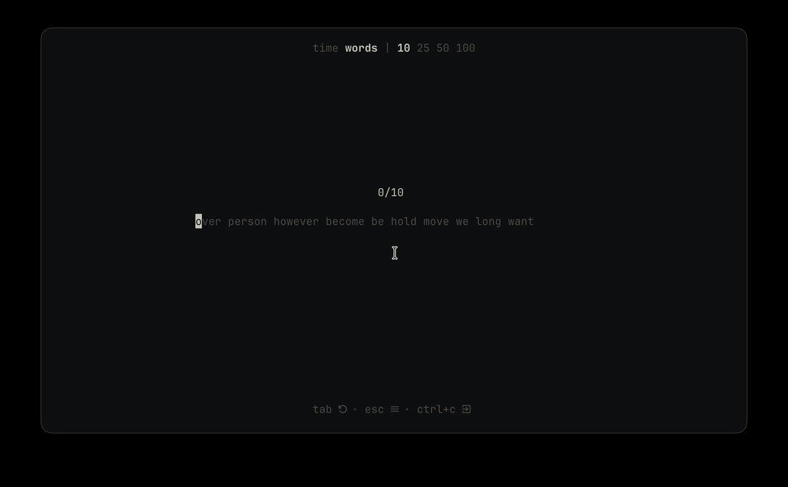

# stdtype

<div align="center">

**Type fast. Type pretty. Type like a monkey. Right in your terminal.**



`stdtype` is a [monkeytype](https://github.com/monkeytypegame/monkeytype)-style typing test that lives in your shell. Built on the [Charm](https://charm.sh) stack.

</div>

## Install

Grab a binary from [Releases](https://github.com/iamnotrodger/stdtype/releases), or:

```sh
go install github.com/iamnotrodger/stdtype/cmd/stdtype@latest
```

## Usage

```sh
stdtype
stdtype --mode time --duration 60
stdtype --mode words --words 50
stdtype --mode words --words 50 --punctuation --numbers
stdtype --list english_1k --lines 4
```

| Flag            | Description                                       |
| --------------- | ------------------------------------------------- |
| `--mode`        | `time` or `words`                                 |
| `--duration`    | seconds for time mode                             |
| `--words`       | word count for word mode                          |
| `--list`        | word list (`english`, `english_1k`, `english_5k`) |
| `--lines`       | visible lines of text                             |
| `--punctuation` | include punctuation                               |
| `--numbers`     | include numbers                                   |

Every flag also works as an env var, e.g. `STDTYPE_MODE=words stdtype`.

## Keys

| Key      | Action               |
| -------- | -------------------- |
| `tab`    | restart              |
| `esc`    | open command palette |
| `↑`      | move up              |
| `↓`      | move down            |
| `ctrl+c` | quit                 |

## Where things live

Settings and results are stored in your user config directory (`~/.config/stdtype` on macOS and Linux). Your WPM stays between you and your terminal.

## Development

Requires Go 1.27+ and [Task](https://taskfile.dev).

```sh
go run ./cmd/stdtype   # run from source
task test              # run tests
task lint              # lint
task --list            # all tasks
```

## License

[GPL-3.0](./LICENSE)
